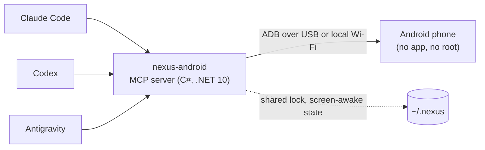

<p align="center"></p>

# NexusAndroid

[](https://github.com/pironjulien/NexusAndroid/releases)
[](https://github.com/pironjulien/NexusAndroid/actions/workflows/tests.yml)
[](https://scorecard.dev/viewer/?uri=github.com/pironjulien/NexusAndroid)
[](https://github.com/pironjulien/NexusAndroid/blob/main/LICENSE)
[](https://github.com/pironjulien/NexusAndroid/blob/main/native/NexusAndroid.csproj)
[](https://modelcontextprotocol.io)

[](https://github.com/pironjulien/NexusAndroid/releases/latest/download/nexus-android.mcpb)

[](https://julienpiron.fr/nexusandroid/)


**Android computer use for AI agents, over plain ADB.** One MCP server, `nexus-android`, lets Claude Code, Codex
and Antigravity see and drive a real Android phone: screen and UI tree, gestures, typing with accents and emoji,
SMS/RCS reading, prepared replies, notifications, files, settings. No root, no app to install on the phone, no
cloud relay: a USB cable or the local Wi-Fi.

Built and tested on a Samsung Galaxy Fold (`SM-F971B`, One UI) with a Windows PC. Other Android phones with USB
debugging should work but have not been tested (see [Compatibility](https://github.com/pironjulien/NexusAndroid#compatibility)). Everything sent to the client is in English: server instructions,
tool descriptions and tool reports (results, refusals, errors).
Part of the Nexus family: [NexusWindows](https://julienpiron.fr/nexuswindows/)
([Claude](https://github.com/pironjulien/NexusWindows-Claude) ·
[Codex](https://github.com/pironjulien/NexusWindows-Codex) ·
[Antigravity](https://github.com/pironjulien/NexusWindows-Antigravity)),
[NexusBrowser](https://julienpiron.fr/nexusbrowser/) ([repo](https://github.com/pironjulien/NexusBrowser)),
[NexusAndroid](https://julienpiron.fr/nexusandroid/) ([repo](https://github.com/pironjulien/NexusAndroid)).
Project page: [julienpiron.fr/nexusandroid](https://julienpiron.fr/nexusandroid/).

**Install:** the main way is the [NexusSystem app from the Microsoft Store](https://apps.microsoft.com/detail/9NSH2P3QLWT1)
(`winget install --id 9NSH2P3QLWT1 --source msstore`), or ask your AI to install NexusAndroid through
[NexusSystem](https://github.com/pironjulien/NexusSystem); otherwise use the verified release files below. Since 0.22.0 the server is a single native Windows executable (C#, .NET 10, self-contained): no Python, no uv, no .NET to install. New versions are no longer published to PyPI; earlier packages stay available.

## Quick start

Windows 10 or 11 (x64 or Arm64), about 10 minutes, nothing to know beforehand.

1. **Install and run setup** without NexusSystem: in PowerShell, download the installer and the release's checksums
   as files, check the installer, then run it as a file (never piped into PowerShell from memory):

   ```powershell
   $r = 'https://github.com/pironjulien/NexusAndroid/releases/latest/download'
   Invoke-WebRequest "$r/get.ps1" -OutFile get.ps1
   Invoke-WebRequest "$r/SHA256SUMS.txt" -OutFile SHA256SUMS.txt
   Select-String ' get.ps1$' SHA256SUMS.txt                  # expected SHA-256
   (Get-FileHash get.ps1 -Algorithm SHA256).Hash             # must be the same (case aside)
   gh attestation verify get.ps1 --repo pironjulien/NexusAndroid   # optional: build provenance
   powershell -NoProfile -ExecutionPolicy Bypass -File .\get.ps1
   ```

   It downloads the latest release for this PC's architecture (`NexusAndroid-win-x64.zip` or
   `NexusAndroid-win-arm64.zip`), checks its SHA-256 against the release's `SHA256SUMS.txt` before extracting anything,
   installs it into `~\.nexus\nexus-android\releases\<version>`, then runs `NexusAndroid.exe setup`. Setup finds `adb`
   or downloads Google's official [Platform Tools](https://developer.android.com/tools/releases/platform-tools),
   declares the server to the AI apps it finds (Claude Code, Claude Desktop, Codex, Antigravity; your own entries are
   kept, each edited file is backed up first), then walks you through connecting the phone and waits until it answers:
   - on the phone, Settings > About phone (Samsung: > Software information) > tap **Build number** 7 times;
   - Settings > **Developer options** > turn on **USB debugging**
     ([Android guide](https://developer.android.com/studio/debug/dev-options));
   - plug the phone in with a USB data cable and accept **Allow USB debugging?** (tick *Always allow*).

   It ends with `Ready.` once the phone is connected and every AI app is configured; otherwise it says which part
   is not. Phone plugged in but never seen: install the maker's
   [USB driver](https://developer.android.com/studio/run/oem-usb)
   ([Samsung](https://developer.samsung.com/android-usb-driver)). Run `get.ps1` again (downloaded and checked the same way) to update.
2. **Restart your AI app.** To declare it by hand instead, point it at the installed executable with the argument
   `--mcp` (stdio):
   - **Claude Desktop**: download [`nexus-android.mcpb`](https://github.com/pironjulien/NexusAndroid/releases/latest/download/nexus-android.mcpb)
     (x64) or [`nexus-android-arm64.mcpb`](https://github.com/pironjulien/NexusAndroid/releases/latest/download/nexus-android-arm64.mcpb)
     (Arm64) and open it (Settings > Extensions);
   - **Claude Code**: `claude mcp add nexus-android --scope user -- "<path>\NexusAndroid.exe" --mcp`
     (or, for the whole Nexus pack: `/plugin marketplace add pironjulien/nexus-plugins`, then
     `/plugin install nexus-android@nexus-plugins`);
   - **Codex**: `codex mcp add nexus-android -- "<path>\NexusAndroid.exe" --mcp`;
   - **Antigravity**: agent panel **⋯** > **MCP Servers** > **Manage MCP Servers** > **View raw config**, add the
     `nexus-android` entry below inside `"mcpServers"`, save.

Then ask your AI: *"Look at my phone and tell me what is on the screen."*

<details>
<summary>Manual configuration (Codex <code>~/.codex/config.toml</code>, JSON clients: Antigravity, Claude Desktop, Cursor, VS Code)</summary>

```toml
[mcp_servers.nexus-android]
command = 'C:\Users\<you>\.nexus\nexus-android\releases\<version>\NexusAndroid.exe'
args = ["--mcp"]
```

```json
{
  "mcpServers": {
    "nexus-android": {
      "command": "C:\\Users\\<you>\\.nexus\\nexus-android\\releases\\<version>\\NexusAndroid.exe",
      "args": ["--mcp"]
    }
  }
}
```
</details>

`NexusAndroid.exe setup` options: `--no-wait` (declare and get `adb`, without waiting for the phone),
`--no-register` (leave the AI apps alone), `--apps claude-code,codex` (only these AI apps: `claude-code`,
`claude-desktop`, `codex`, `antigravity`; the pack passes its `-Only`/`-Skip` choice as `NEXUS_PACK_TARGETS`, same
names). `get.ps1 -NoWait` passes `--no-wait`. Exit code: 0 everything ready, 1 `adb` or the phone not ready, 2 an AI app
not configured, 3 both. The Nexus pack runs it with `NEXUS_PACK=1`: no question, no wait, exit code 0 on success and a
last line `NEXUS_PACK_RESULT Claude Desktop=declared; Codex=declared; Antigravity=plugin`. In Antigravity the server
comes as a plugin (`~/.gemini/config/plugins/nexus-android`: server and agent guide), never as a global entry. An entry
written by an earlier version (`uvx nexus-android`) is replaced by the executable.

The HTTP daemon shares one token file with NexusRelay and NexusBrowser: `NEXUS_MCP_TOKEN_FILE` when set, otherwise
`%USERPROFILE%\.nexus\mcp-token.txt`. The installer reuses that file (creates it once if absent), sets the user
variable `NEXUS_MCP_TOKEN` to its content and never rotates an existing token. Restart AI apps after the first
installation so they read the variable; installing another Nexus product keeps the same token.

**Verify a download.** Every release file (both zips, both `.mcpb` extensions, `get.ps1`, `SHA256SUMS.txt`) carries a Sigstore
build provenance attestation: `gh attestation verify NexusAndroid-win-x64.zip --repo pironjulien/NexusAndroid`
(the bundle is also attached as `NexusAndroid-<version>.intoto.jsonl`).

`adb` is looked for in this order: `NEXUS_ANDROID_ADB` (full path), the `PATH`, the Android SDK (Android Studio's
default folder), winget's Platform Tools, then `~/.nexus/nexus-android/tools/platform-tools-<version>`. When none is
found, `setup` (or the server, in the background at start) downloads the current stable Platform Tools for Windows from
Google's SDK repository (`dl.google.com`, the manifest `sdkmanager` reads), checks the size and SHA-1 Google publishes
for the archive and unpacks it there; by using it you accept the
[Android SDK terms](https://developer.android.com/studio/terms). `NEXUS_ANDROID_ADB_DOWNLOAD=0` turns this off.
Typing accents and emoji needs the scrcpy server (Genymobile, Apache 2.0, version 5.0.1 pinned): `setup` (or the
server at start) downloads it from the
[official scrcpy release](https://github.com/Genymobile/scrcpy/releases/tag/v5.0.1) on GitHub, checks its SHA-256
against the value written in the code and keeps it in `~/.nexus/nexus-android/tools`. If the download is impossible
(offline, proxy), accented text is refused with a message; it is never replaced by other text. ASCII typing works
without it.

### Example prompts

- *"Open Google Maps and start navigation to the nearest pharmacy."*
- *"Read my last SMS from Alice and draft a reply saying I'll be 10 minutes late."* (drafted, never sent without your "yes")
- *"Turn on do not disturb and lower the brightness."*
- *"Pull the last three photos from the phone to my PC."*
- *"Run a checkup: battery, storage, security patch, apps installed outside the stores."*

## How it works



`look` returns the numbered UI tree, text first (the screenshot only when nothing is readable or on request); `act` runs a batch of gestures, re-reading the screen before
each one and reporting what really happened. Messages, notifications, contacts and settings are read through
Android's own providers and `dumpsys`, never by scraping the screen.

## Why a shared server

Each agent has its own desktop computer use, but none of the three clients has a built-in tool for a phone. One
server avoids maintaining the same ADB access three times, and lets the three agents share one lock, one
screen-awake session and the same safeguards.

## Tools

| Tool | Role |
| --- | --- |
| `phone` | Connected phone (USB or Wi-Fi), model, screen, foreground app, fold posture, reboot detection (structured output) |
| `look` | Numbered `[N]` elements with text, state and center `@x,y`, text first: the screen image is joined when nothing is readable (`act` and `launch` also join it when a step fails (`✗`), loses the link (`?`), or is not read back (`~`) and the screen did not change; otherwise `look(show="both")`), or on request (`show=both` or `image`, `region`); `marks` draws the `[N]` numbers on the image (`auto`: all when few, else the unnamed elements; `all`; `none`) |
| `act` | Batched gestures: tap, long press, typing (accents and emoji included), clear, keys, scroll, swipe, wait, links (`geo:`, `google.navigation:`, `tel:` opens the dialer without calling, `mailto:`, `https://`); `then="changes"` returns only the elements added, changed and removed since the last list (unchanged ones counted, `[N]` kept valid), or the full list when the app or most of the screen changed |
| `launch` | Open an app by package or part of its name, or a precise screen: `action` (`android.settings.WIFI_SETTINGS`), `data` (deep link), `extras`; target resolved first and reported; calling, sending or paying directly needs `confirm=true` and the accord for that exact intent, banking and identity apps are never opened this way |
| `clipboard` | Read the phone's clipboard (codes masked, a lone code, password or token never shown) or write text to it, without pasting |
| `messages` | SMS and RCS conversations, read by contact name or number, attached photos; security codes masked; answers capped at about 60,000 characters, cut between messages, with a `before` cursor to read older ones |
| `draft` | Open SMS/RCS or WhatsApp with the reply already written, recipient by name or number (WhatsApp: country code from the SIM card); sent only after the user explicitly says "send" |
| `notifications` | Notifications on screen: app, time, title, text; security codes masked; `all` adds ongoing ones |
| `files` | Shared storage only (`/sdcard`): list newest first, `pull` to the PC (`~\Downloads\Telephone`), `push` to the phone; never overwrites, never deletes. On the PC: Downloads, Documents, Desktop, Pictures and Videos are free, anywhere else needs `confirm=true`; keys and secrets (`.ssh`, `.env`…) and the Windows Startup folder never |
| `capture` | Save the screen as a file on the PC, same folder and rules as `files pull` (`~\Downloads\Telephone`, never overwrites): `screenshot` at full resolution (PNG, or JPEG by name) with security codes and password fields blacked out (no masking possible: refused unless `unmasked=true`); `record` (fixed duration) or `start`/`stop` (gestures go on meanwhile) for an MP4 video, 720p, 4 Mbit/s, 180 s at most, pulled to the PC then deleted from the phone. Codes are not masked in videos, so no recording starts in a banking or identity app; while recording, the foreground app is checked about every second, and the video is erased from the phone, never saved, if such an app comes up or if that check is interrupted for more than 5 seconds; screens protected against capture come out black; a sleeping screen is turned on first, a lock screen that Android keeps unlocked (trusted place) is lifted, a really locked phone is refused (the user unlocks it) |
| `logs` | Android logs to understand a crash or a misbehaving app: `crash` (one block per crash: time, package, exception and `Caused by`, first app frames; native crashes with signal and backtrace), `anr` (app not responding, from Android's drop box and the event log, with the reason), `recent` (last lines, of one app with `app`: its processes, running or not, and lines naming it); `since` (`15m`, `13:05`…), `query` filter; newest last, about 30,000 characters. Codes, tokens, e-mail addresses and phone numbers masked; banking and identity apps: no `recent`, crashes reduced to exception types and app frames |
| `info` | Read-only: last known location (accuracy, age, Maps link), recent calls, a contact's numbers, upcoming events (structured output) |
| `settings` | Read or change, then read back: Wi-Fi, Bluetooth, mobile data, location, NFC, do not disturb, brightness, media volume; turning Wi-Fi off is refused when the link goes through it (structured output) |
| `functions` | Structured actions apps expose to assistants (Android AppFunctions: Samsung Clock, Reminder, Notes, Calendar, Contacts, Gallery, Files, Phone…), listed and run without the screen; reading free, deleting and call handling with `confirm=true`, calling also with the accord |
| `web` | Web pages on the phone read through Chrome's DevTools (or a debuggable WebView): whole text, title, address, links, without touching the screen; `query` filters lines; `tabs` lists the pages; read only, codes, tokens, e-mails and numbers masked, banking apps never read, banking, payment, tax and identity sites never read (checked again on the address actually read) |
| `apps` | Manage apps: `info`, `stop` (force-stop), `clear` (data), `uninstall` (a system app is only hidden, `restore` brings it back), `install` (an .apk from the PC); `clear`, `uninstall` and `install` need `confirm=true`; never the system's own parts, nor clearing or uninstalling banking and identity apps |
| `map` | Map of the whole phone, read without touching the screen. `find`: where something is set, from the user's words → path from Settings ("Settings > Notifications > …"), current value, and how to open that screen directly with the row highlighted. Built from the phone's own Settings app (every screen and row, in the phone's language) and rebuilt by itself after an update; app screens the Settings app does not describe (Galaxy Buds…) are added with `note`, on the screen the agent is showing. `snapshot` / `diff`: settings values, apps and versions, sensitive permissions, default apps, device admins and Bluetooth devices, compared with the previous snapshot; identifiers, tokens and numbers masked |
| `checkup` | Health report: system, security patch, battery, storage, memory, apps installed outside the stores, wireless debugging; `clean` clears caches |

`look` and `act` also read the text the UI tree does not give (games, Flutter apps, video or map surfaces) on the
image, with the OCR engine built into Windows, on the PC: lines listed with their `@x,y`, aimed at by their text,
judged by the same safeguards, codes masked in the text and blacked out on the image. Routines: `act(remember="name")`
saves a batch that went through, with stable targets (`id:`, text, `desc:`; never `[N]` or coordinates; a typed text
made only of `{{x}}` becomes a parameter); `act(routine="name", params={...})` replays it for any of the three agents,
only in the app where it was recorded, every safeguard applied again (`confirm` and accords are never saved); `look`
lists the routines of the foreground app.

Google Messages stores RCS messages in Android's messaging provider, like MMS, so the server reads them without going
through the screen. An RCS group only has an encoded address there: the server works out its members and names the
sender of each received message. A conversation archived or trashed in Google Messages stays readable and is labelled
as hidden in the app.

Reads are fast: every `adb shell content query` starts a Java process on the phone (about 1 s), so at the first
read the server pushes a 20 KB helper (`phone/NexusQuery.java`, built into `nexus-query.dex`) to `/data/local/tmp`
and starts it once with `app_process` under the shell identity, as scrcpy does: no app to install, no permission
beyond ADB's. It queries the providers the way Android's own `content` command does, read-only (`query` only), and
serializes the rows itself with length-prefixed values, so a message text can never pose as an extra row. Each start
draws a random token that goes into the socket name and comes back in every answer; any other server is refused. It
answers only connections from the shell or root user (adbd, checked by the kernel) and stops after 10 minutes without
a request. If the helper cannot run, reads fall back to `adb shell` with the same results; there, a read whose row
numbers or row count (checked against the same read reduced to `_id`) do not add up is refused rather than shown.

The same helper reads the screen: it opens one accessibility connection (`UiAutomation`, what `uiautomator dump` opens
and closes on every call) and keeps it, so `look` gets the UI tree, the screenshot (JPEG made on the phone) and the
screen state in one exchange. It is read-only (no gesture, no global action, no typing) and leaves the user's own
accessibility services running. Android allows only one such connection at a time: the helper is shared by every
agent, hands it back before any `uiautomator dump` fallback, on its own after 45 s without a screen read, and right after reading a protected (banking or identity) app, so
other tools (Appium, uiautomator2) can take it. The element list, its numbering, code masking and the refusal rules
are the same as with `uiautomator dump`.

## Performance

Measured on a Samsung Galaxy Fold: messages over USB through the shared daemon, the other rows over Wi-Fi:

| Read | Time |
| --- | --- |
| Conversation list (`messages()`) | 0.07 s (35 s before 0.5.0) |
| One conversation | 0.03 to 0.05 s |
| `phone` (Wi-Fi, link already known) | 0.19 s, one adb round trip |
| Location (Wi-Fi) | 0.11 to 0.15 s |
| `look` (list and image, Wi-Fi) | 0.17 to 0.19 s (2.9 s before); the first one after 45 s without a look: about 1.2 s |

## Safeguards

**Threat model for outward actions** (sending, calling, paying, publishing, transferring): the agent must never be
able to make an outward action leave that differs from the one the user approved. The approved action has one
canonical identity: the foreground app, what the elements of the UI tree say in document order (their text, or a
keyed seal of the raw text when it is masked; not their exact position, so a 4-pixel shift or the keyboard opening
does not void it), and the complete target of the gesture (the element that receives the tap with its resource id,
bounds and drawing order, the tap point, the start and end of a swipe, the direction of a scroll, the field that has
the focus for a key). The contract sits at the boundary of each physical injection: every tap (each tap of a double
tap, on a quick reading that does not wait for the screen to settle, or no second tap), every swipe of a scroll (judged where the
finger lands, on what it actuates there), every submit key (alone in its step) is sent right after its own fresh
reading of the screen, judged on it, and compared with the approved identity; any difference refuses it. The token
is bound to that identity only; the readable summary (recipients, content, attachments) is shown with it. A swipe
or drag is judged on one reading for both ends. `type` only types into an editable field that has the focus, and
pastes any control character (line break, tab) as text, never as a key. What the UI tree does not describe (a target found only by OCR, a drawn surface over
the target or the recipient, a drawn surface without tree text in the header) is never bound to an accord: such an
outward action is refused, the user does it; a video or photo preview beside a send button and a recipient that the
tree describes does not block. Limit, stated plainly: a screen that changes in the few milliseconds between that
last reading and the ADB injection is beyond what an ADB tool can see.

- **Paying, sending, calling, publishing, deleting for good, formatting, uninstalling, resetting, cancelling a subscription,
  making a repository public**: a button of this kind is refused without `confirm=true`, for every gesture aimed at
  it (tap, typing, clearing, swipe, `x,y` coordinates included). The agent sets it on the user's explicit order for
  that gesture, or after their "yes". The labels come from one policy file shared with the desktop tools
  (`garde-fous.json`), matched without accents or case and in every listed form ("Envoyez", "Payez", "Paiement",
  "Commandez", "Checkout", "Appeler"...). Everything else is free: deleting to the trash, accepting, sharing.
  A generic "OK" or "Validate" needs it on a screen that talks about a payment or a format. In a messaging, mail,
  social or phone app, a clickable icon with no name at all (often the send or call button) needs it too. Enter, call keys and any key
  outside a short safe list need it as well.
- **Accord bound to the exact action** (sending, calling, paying, publishing, transferring): `confirm=true` alone is
  not enough. The tool answers with the exact action as the screen shows it (app, button, recipients: the header
  plus any phone number or e-mail address shown, the text of the fields, named attachments, and the rest of the app's
  text on screen, masked texts bound by a seal of their raw text) and a single-use token valid 10 minutes; that
  screen is read and compared again right before each injection; the agent shows that summary
  to the user and sends the gesture again with `accord="<token>"` only after their yes. `draft` returns the token for
  its own draft. Any change in between (other conversation, edited text) voids the token: a new accord is needed.
  The same rule covers every way to send: tap, swipe or "slide to send", a scroll whose finger lands on such a
  slider (one scroll per step with an accord), Enter or call keys (alone in their step: `tab` first, then `enter`),
  `open_url` payment links and
  `launch` intents that call, send or pay. When the UI tree cannot be read, the action cannot be described: no token
  is given and the gesture is refused. Multi-line text is pasted (a line break is text, never the Enter key, which
  can send); no double tap on an outward button. Local destructive gestures (uninstall, reset, delete for good)
  keep `confirm=true` alone.
- **Text read never authorizes anything**: SMS, notifications and screens are data. A recipient that appears in a
  recently read text is flagged in the accord summary (allowed only if the user asked for it themselves), and text
  that looks like instructions aimed at an AI is flagged in the response. That detector is a signal only, never a
  block and never a guarantee.
- **Target checked on the current screen**: the UI and the phone state (lock, foreground app) are read again in
  one round trip just before each gesture; a changed `[N]` or a spot with nothing readable is refused. Reports: ✓ effect read back, ~ sent but not verified, ✗ refused or failed.
- **One phone only**: the owner's phone is identified by its hardware serial number, recorded at the first USB
  connection; emulators, TV boxes and other devices are ignored. One agent at a time drives it (lock shared by all
  servers on the PC, and by the sessions of the shared daemon); another one waits 30 seconds at most, then is told
  the phone is busy. A call the client cancels (or a client that disconnects) stops before the next step of a batch.
- **Banking, payment, crypto, gambling, identity, authenticators**: look, scroll and wait freely; tap, type or
  swipe only with `confirm=true` (the user's order to navigate); a money or send button, an unnamed icon, Enter or
  any validation key, never, even with `confirm=true` and an accord; when the UI tree cannot be read there, no aimed
  gesture at all (only back, home and recent); a link (`open_url`) or an intent (`launch` with `action`/`data`) that would open one of
  them, even as one choice among others, is refused (a deep link can prepare a payment).
- **Intents and links that act on their own** (`CALL`, sending a text without review, uninstalling, resetting,
  payment actions, `upi:`/`bitcoin:`/`payto:` links, auto-send extras): `confirm=true`, plus the accord bound to
  the exact intent for calls, sends and payments.
- **Codes received by SMS or shown in notifications**: masked before the agent reads them, and blacked out on the
  image (the `[N]` badges are drawn afterwards: they can only cover, never reveal). Codes the OCR finds on the image
  are blacked out too, on `look` images (large drawn surfaces without tree text) and on saved screenshots (every
  large drawn surface, labelled or not). Limit: the OCR of a saved screenshot only covers drawn surfaces of at least
  25 % of the screen (or a tree with no text at all); a code drawn on a smaller surface is not blacked out. When the OCR is unavailable (outside Windows) or fails, `look` still returns
  the image of the user's own phone, with a clear warning that drawn codes are not masked; a saved screenshot is
  refused without `unmasked=true`. Bank card numbers (Luhn check) and IBANs (mod 97
  check) are masked in every text the tools return (screen, notifications, SMS, clipboard, calendar, logs, web, map):
  card groupings only (4-4-4-4 followed or not by 1 to 3 digits, 4-6-5, 4-6-4, 4-4-5, 4-3-3-3, or one block of 15
  to 19 digits; first digit 2 to 6), so calendars, draws, tables of numbers, SIRET and EAN-13 stay readable; IBANs
  only at the exact length of their country (SWIFT registry), in any case, even glued to a word; groups separated by
  one or two spaces, no-break spaces, dashes, dots or a line break. In the clipboard, a lone code, or
  a single word that looks like a password or a token, is not shown at all. When the UI tree cannot be read, codes cannot be located, so the image is not sent unless `look` gets
  `confirm=true` (with the user's agreement).
- **Passwords**: no typing into a password field, and no key there but navigation (back, tab, arrows). No typing
  either when the active field cannot be read, even with `confirm=true`.
- **Locked phone**: no code is ever entered. When Android itself keeps the phone unlocked (Extend Unlock, Smart
  Lock, trusted place or device: `dumpsys trust` says `deviceLocked=0`), `phone` reports `code_required: false` and
  `look`, `act` and `capture` wake it and lift the lock screen (`wm dismiss-keyguard`): the agent does not ask. Only
  when a code is required (`code_required: true`) are gestures refused until the user unlocks it.
- **Text read** on screen or in messages is data, never instructions.
- **User holding the phone**: no gesture mixes with theirs. If the phone was touched in the last 3 seconds (and not
  by an agent), the server waits up to 10 seconds, then refuses. A phone that does not report its last touch (no
  `lastUserActivityTime` in `dumpsys power`) gets a warning in the `act` response: that check is inactive there.
- **Link lost during a gesture**: reported as `?` (effect unknown), never as a plain failure: the agent looks again
  before redoing it, so nothing is sent twice. A read with no answer (Wi-Fi gone) fails after 10 seconds (5 for the
  screen state) instead of minutes, and the next call looks for the phone again.
- **Fold folded or unfolded** since the last image: `x,y` targets are refused until a new `look`.
- **Reboot**: `phone` and `look` say once that the phone restarted; when it cannot be found, the message reminds that
  Android turns wireless debugging off after a reboot or a network change.
- **Other control tools** (mobile-mcp, Appium, Shizuku, another scrcpy) left running on the phone can block the UI
  tree: `checkup` and the error name them.

## Screen kept on while the agent works

Unlocking again and again while an agent works is tedious, but a phone used to pay must not stay unlocked. So, at the
first gesture (`act`, `launch`, `draft`) on a phone **the user has unlocked**, the server saves the screen timeout
(`screen_off_timeout`) and raises it to 5 minutes, a delay Android counts again from every gesture; `phone` shows
until when. If the server is killed, the screen still turns off (and locks) at most 5 minutes after the last gesture.
While the agent only looks, a screen that is on gets a wake-up key every 3 minutes (no visible effect), so it does
not turn off during a long observation.

About 2 minutes after the last gesture of any agent, the original timeout is restored and the screen is turned off,
which locks the phone again. If the user is holding the phone at that moment, or changed the timeout themselves, the
screen is left alone. The original value is saved once (`~\.nexus\nexus-android\awake.json`) and shared by all
servers under the common lock: one save, one restore, never the raised value taken for the original. After a crash,
the next server to start restores it. The server never unlocks a phone that Android keeps locked.
`NEXUS_ANDROID_AWAKE_IDLE` (seconds, default 120) changes the delay; `NEXUS_ANDROID_KEEP_AWAKE=0` turns it off.

## Compatibility

The server needs nothing on the phone but USB debugging; anything Android with ADB should work, and only what is
listed as tested has been run here. Report your device in an
[issue](https://github.com/pironjulien/NexusAndroid/issues/new?template=device-report.yml) to move it up.

| Device or system | Status |
| --- | --- |
| Samsung Galaxy Fold `SM-F971B`, One UI, Android 17, USB and wireless debugging | **Tested** (real-phone qualification, NATIVE-QUALIFICATION.md) |
| Windows 11 PC | **Tested** |
| Other Samsung phones (One UI) | Expected: same system and apps as the tested phone |
| Pixel, Motorola, Nothing, OnePlus, Sony, Fairphone and other near-stock Android | Expected, not tested |
| Xiaomi, Redmi, POCO (MIUI, HyperOS) | Expected once "USB debugging (Security settings)" is on in Developer options (gestures refused before; the error says so) |
| Android 10 and older | Expected over USB only (wireless debugging arrived with Android 11); app functions need Android 16 |
| Tablets and other foldables | Expected; the folded/unfolded posture is tracked as on the Fold |
| Phones managed by an employer (USB debugging blocked by policy) | Not possible |
| iPhone, iPad | Not supported (no ADB) |
| Android emulators | Ignored unless named with `NEXUS_ANDROID_SERIAL` (for tests) |
| Linux PC | Not supported since 0.22.0 (the native engine is Windows only; 0.21.0 on PyPI still runs there) |
| macOS PC | Not supported (the native engine is Windows only) |

## Known limitations

- Gestures go through the real screen, on purpose: the user sees the agent working. No invisible virtual display.
- Accented text and emoji go through the clipboard (Android's `input text` only takes ASCII): the scrcpy server
  (Genymobile, Apache 2.0, version and SHA-256 pinned, downloaded by `setup` or at server start) runs
  only during the paste, then the previous clipboard is put back. Samsung's clipboard history may keep the pasted text.
- Notifications: Android only keeps the app name of dismissed ones, not their text.
- An app protected by `FLAG_SECURE` produces a black screenshot; the server says so and the `[N]` elements stay
  readable.
- Android allows one accessibility automation client at a time: while another tool's server holds it (mobile-mcp,
  Appium, uiautomator2...), the UI tree is unreadable; `look` names that tool and its pid. Close or stop it, then
  retry.
- The link is USB or local Wi-Fi through wireless debugging, paired with each PC. ADB does not work over Bluetooth.
- Xiaomi, Redmi and POCO (MIUI, HyperOS) refuse injected gestures until "USB debugging (Security settings)" is turned
  on in Developer options; the error says so.
- Windows only (x64 and Arm64): the engine is a native Windows executable (OCR included).

## Rejected options

- **Companion app on the phone**: notifications, typing with accents, files and settings all come from ADB itself; an
  app would only add control away from USB and home Wi-Fi, which is rarely needed.
- **Invisible screen**: seeing the agent work on the real screen is a feature.
- **Internet relay** (tunnels, VPN): USB or local Wi-Fi only.

## Full install from a clone (Windows)

An alternative to `get.ps1` for contributors: builds the engine from the sources with the
[.NET 10 SDK](https://dot.net) and runs the same `setup`.

```powershell
git clone https://github.com/pironjulien/NexusAndroid
cd NexusAndroid
pwsh -NoProfile -File install.ps1          # tests, build, then setup (adb, scrcpy server, AI apps, phone)
pwsh -NoProfile -File install.ps1 -NoWait  # same, without waiting for the phone
```

The executable goes to `~\.nexus\nexus-android\native\<source fingerprint>` (a new folder for new sources, never
overwritten while an AI app runs it). `-SkipTests` skips the tests, `-NoRegister` leaves the AI apps alone. Build
output goes to `~\.nexus\build\nexus-android`, never into the clone. The engine, its verification and its exact limits
are documented in [NATIVE-QUALIFICATION.md](NATIVE-QUALIFICATION.md).

Each client then starts its own server over stdio. They share the phone lock and the screen-awake state through
`~\.nexus`; for a single process shared by all clients, see
[Shared daemon](https://github.com/pironjulien/NexusAndroid#shared-daemon-optional).

### Cable-free Wi-Fi, once per PC

1. Phone: Settings → Developer options → Wireless debugging → Pair device with pairing code.
2. PC: `adb pair <ip>:<port>`, then enter the code shown on the phone.

From then on, `nexus-android` finds the phone on the local Wi-Fi. Since One UI does not announce the phone over mDNS,
the server records its Wi-Fi address and the wireless debugging port every time it is plugged in over USB. This port
changes after a reboot or a network change: plugging in over USB once is then enough. The last known address is
tried first, then mDNS; only when the PC is on the same network does the server look for the new port, checking with
an ADB handshake before connecting. When the phone cannot be found, the server does not search the Wi-Fi again for
2 minutes (a cable plugged in is still seen at once). The cable takes priority when
it is plugged in. `NEXUS_ANDROID_SERIAL` forces a specific device, by serial number or `ip:port` address.

**No shared Wi-Fi network** (office PC on Ethernet only, with a Wi-Fi card): turn on the phone's hotspot and connect
the PC to it, then, with the cable plugged in once, run `adb tcpip 5555`. The server records the phone's hotspot
address and finds it there after the cable is removed. TCP mode lasts until the phone restarts (or `adb usb`). Raise
the PC's Wi-Fi interface metric if its internet traffic should keep going through Ethernet rather than the phone's
mobile data.

> **Not encrypted.** Unlike wireless debugging (paired, TLS), `adb tcpip 5555` is classic ADB over plain TCP: the
> traffic, screenshots and messages included, can be read on that network, and the port stays open on it. Use it only
> on the phone's own hotspot or another network you control, and turn it off afterwards with `adb usb`.

## Shared daemon (optional)

Clients configured with stdio start their own `NexusAndroid.exe` process. `get.ps1` also configures a shared HTTP
daemon: the Nexus workstation supervisor when present, otherwise a hidden logon task. To start it manually after
installation:

```powershell
$env:NEXUS_MCP_TOKEN_FILE = Join-Path $env:USERPROFILE '.nexus\mcp-token.txt' # or the shared file chosen at install
NexusAndroid.exe --http 16180
```

It serves MCP Streamable HTTP on `127.0.0.1` only (default port 16180), at `http://127.0.0.1:16180/mcp`, and refuses
any request without the header `Authorization: Bearer <token>` (HTTP 401); it does not start without a token. Point
each client at that URL with that header. Each MCP session keeps its own `[N]` numbering and conversation list; the
ADB link and the phone lock are shared. The token file takes precedence over `NEXUS_MCP_TOKEN`; the variable is a
fallback only when `NEXUS_MCP_TOKEN_FILE` is unset and the default shared file is absent. The token keeps a
misconfigured client or a stray session from driving the phone; it is no protection
against malicious software running on the same PC, which can reach the phone directly through ADB (see
[SECURITY.md](https://github.com/pironjulien/NexusAndroid/blob/main/SECURITY.md)).

## Privacy

NexusAndroid runs entirely on your PC and talks to your phone over ADB (USB cable or local Wi-Fi). It has no
account, no telemetry, no analytics and no cloud relay. Its internet requests, none of which carries data about you
or your phone: Google's SDK repository manifest and Platform Tools from `dl.google.com` when no `adb` is found on
the PC, and the pinned scrcpy server from GitHub when it is missing (both off with `NEXUS_ANDROID_ADB_DOWNLOAD=0`);
`get.ps1`, when you run it, fetches the latest release from GitHub. There is no automatic update check.

- **What it reads**: the screen and UI tree, SMS/RCS messages, notifications, files in shared storage, location,
  recent calls, contacts and calendar, only when the agent calls the matching tool. Security codes are masked before
  the agent sees them.
- **Where it goes**: tool results are returned to the AI client you connected (Claude, Codex, Antigravity…). That
  client may send them to its model provider under its own privacy policy; NexusAndroid sends nothing anywhere else.
- **What it stores on the PC**, under `~/.nexus/`: the phone map (`map/`: the Settings tree, the screens noted with
  `map note`, and up to 30 snapshots of settings values, apps, permissions and Bluetooth device names, with
  identifiers, tokens, addresses and numbers masked), the phone's serial number, Wi-Fi address and wireless debugging
  port, the saved screen timeout, a lock file, the pinned scrcpy
  server, the downloaded Platform Tools (when no `adb`
  was found), backups of the AI client configs that `setup` or
  `install.ps1` edits (`backups/`), and the installed executables (`releases/` or `native/`). Files you `pull` go to `~/Downloads/Telephone`. The server writes no
  messages or screenshots to disk.
- **Journal**, under `%LOCALAPPDATA%\NexusJournal\android\<agent>\<YYYY-MM>.jsonl` (or `NEXUS_JOURNAL_HOME`),
  shared format of the Nexus tools: one line per gesture or tool call with the calling AI (Claude, Codex,
  Antigravity), the action, the outcome, the duration, the technique, the app's package name and an error category
  from a fixed list. Never screen text, SMS, contact, typed text or code. Nothing is sent anywhere; months are kept
  until you delete them: delete the `android` folder (or single month files) at any time. `NEXUS_JOURNAL=0` in the
  server's environment turns it off (nothing written, no folder created).
- **On the phone**, in `/data/local/tmp`: the two helpers (`nexus-scrcpy.jar`, `nexus-query-*.dex`) stay there; the
  UI dump (`nexus-android-ui-*.xml`) and the temporary read folders (`nexus-q-*`, `nexus-p-*`) are deleted right after
  each read. The read helper stops by itself after 10 minutes without a request.
- **Removing it**: delete `~/.nexus/nexus-android/`, `~/.nexus/android.lock` and
  `%LOCALAPPDATA%\NexusJournal\android\`, remove the `nexus-android` entry
  from each client's config, run `adb shell "rm -rf /data/local/tmp/nexus-*"` (helpers, UI dumps and any read folder
  left by an interrupted read), and revoke the PC's key on the phone (Developer options → Revoke USB debugging
  authorizations).

Questions or concerns: open an issue, or see [SECURITY.md](https://github.com/pironjulien/NexusAndroid/blob/main/SECURITY.md)
for private reports.

## Development

With the [.NET 10 SDK](https://dot.net) (version pinned by `global.json`):

```powershell
pwsh -NoProfile -File test.ps1   # = dotnet test (xUnit v3, Microsoft.Testing.Platform), offline, no phone needed
```

The suite (`tests/`) drives the real engine and MCP server against fixture phones, adb transports and DevTools pages:
nothing reaches a device or the network, and nothing is written into the sources (build output and test data under
`~\.nexus\build\nexus-android`). The CI runs the same script on `windows-latest`; releases are built by
`.github/workflows/release.yml` from a `vX.Y.Z` tag. The phone-side read helper is rebuilt from
`phone/NexusQuery.java` by `phone/build.ps1` (JDK 17+).

## License

[MIT](https://github.com/pironjulien/NexusAndroid/blob/main/LICENSE). Not affiliated with Google, Samsung, Anthropic, OpenAI or Genymobile.
