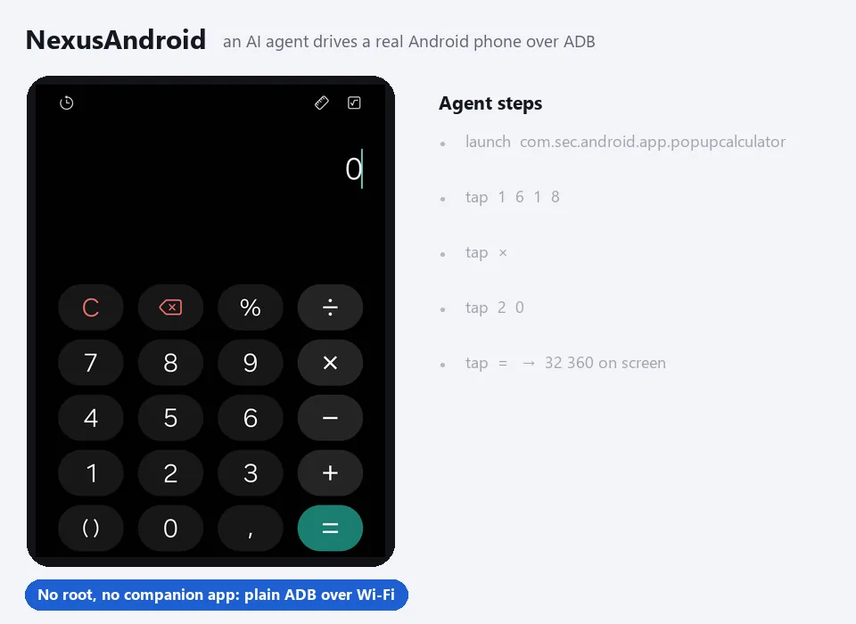
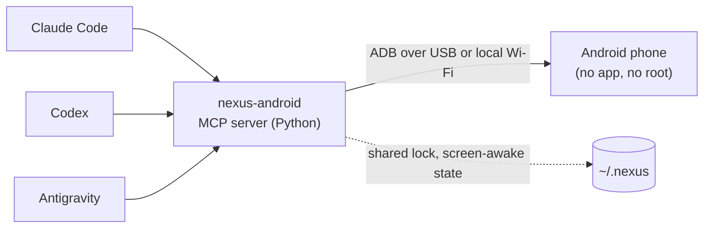

# NexusAndroid

<!-- mcp-name: io.github.pironjulien/nexus-android -->

[](https://github.com/pironjulien/NexusAndroid/releases)
[](https://pypi.org/project/nexus-android/)
[](https://github.com/pironjulien/NexusAndroid/actions/workflows/tests.yml)
[](https://github.com/pironjulien/NexusAndroid/blob/main/LICENSE)
[](https://github.com/pironjulien/NexusAndroid/blob/main/pyproject.toml)
[](https://modelcontextprotocol.io)

[](https://julienpiron.fr/nexusandroid/)



**Android computer use for AI agents, over plain ADB.** One MCP server, `nexus-android`, lets Claude Code, Codex
and Antigravity see and drive a real Android phone: screen and UI tree, gestures, typing with accents and emoji,
SMS/RCS reading, prepared replies, notifications, files, settings. No root, no app to install on the phone, no
cloud relay: a USB cable or the local Wi-Fi.

Built and tested on a Samsung Galaxy Fold (`SM-F971B`, One UI) with a Windows PC. Other Android phones with USB
debugging should work but have not been tested. Agent-facing messages are in French.
Part of the Nexus family: [NexusWindows](https://julienpiron.fr/nexuswindows/)
([Claude](https://github.com/pironjulien/NexusWindows-Claude) ·
[Codex](https://github.com/pironjulien/NexusWindows-Codex) ·
[Antigravity](https://github.com/pironjulien/NexusWindows-Antigravity)),
[NexusBrowser](https://julienpiron.fr/nexusbrowser/) ([repo](https://github.com/pironjulien/NexusBrowser)),
[NexusAndroid](https://julienpiron.fr/nexusandroid/) ([repo](https://github.com/pironjulien/NexusAndroid)).
Project page: [julienpiron.fr/nexusandroid](https://julienpiron.fr/nexusandroid/).

## Quick start

1. Phone: Settings → About phone → tap *Build number* 7 times, then Developer options → **USB debugging** on.
   Plug it in and accept the PC's key on the phone.
2. PC: install [`uv`](https://docs.astral.sh/uv/) and the Android Platform Tools (`winget install Google.PlatformTools`).
3. Add the server to your agent (installed from [PyPI](https://pypi.org/project/nexus-android/) by `uvx`, no clone needed):

```bash
claude mcp add nexus-android --scope user -- uvx --python 3.14 nexus-android
```

Then ask your agent: *"Look at my phone and tell me what is on the screen."*

<details>
<summary>Codex (<code>~/.codex/config.toml</code>)</summary>

```toml
[mcp_servers.nexus-android]
command = "uvx"
args = ["--python", "3.14", "nexus-android"]
```
</details>

<details>
<summary>Antigravity, Claude Desktop, Cursor and other JSON clients</summary>

```json
{
  "mcpServers": {
    "nexus-android": {
      "command": "uvx",
      "args": ["--python", "3.14", "nexus-android"]
    }
  }
}
```
</details>

If `adb` is not on the `PATH`, set `NEXUS_ANDROID_ADB` to its full path in the server's environment. Typing accents
and emoji needs the pinned scrcpy server that [`install.ps1`](#full-install-windows) downloads and checks; without it,
ASCII typing still works.

### Example prompts

- *"Open Google Maps and start navigation to the nearest pharmacy."*
- *"Read my last SMS from Alice and draft a reply saying I'll be 10 minutes late."* (drafted, never sent without your "yes")
- *"Turn on do not disturb and lower the brightness."*
- *"Pull the last three photos from the phone to my PC."*
- *"Run a checkup: battery, storage, security patch, apps installed outside the stores."*

## How it works



`look` returns a screenshot plus the numbered UI tree; `act` runs a batch of gestures, re-reading the screen before
each one and reporting what really happened. Messages, notifications, contacts and settings are read through
Android's own providers and `dumpsys`, never by scraping the screen.

## Why a shared server

Each agent has its own desktop computer use, but none of the three clients has a built-in tool for a phone. One
server avoids maintaining the same ADB access three times, and lets the three agents share one lock, one
screen-awake session and the same safeguards.

## Tools

| Tool | Role |
| --- | --- |
| `phone` | Connected phone (USB or Wi-Fi), model, screen, foreground app, fold posture, reboot detection (structured output) |
| `look` | Screen image and numbered `[N]` elements with text, state and center `@x,y` |
| `act` | Batched gestures: tap, long press, typing (accents and emoji included), clear, keys, scroll, swipe, wait, links (`geo:`, `google.navigation:`, `tel:` opens the dialer without calling, `mailto:`, `https://`) |
| `launch` | Open an app by package or part of its name |
| `messages` | SMS and RCS conversations, read by contact name or number, attached photos; security codes masked |
| `draft` | Open SMS/RCS or WhatsApp with the reply already written, recipient by name or number; sent only after the user explicitly says "send" |
| `notifications` | Notifications on screen: app, time, title, text; security codes masked; `all` adds ongoing ones |
| `files` | Shared storage only (`/sdcard`): list newest first, `pull` to the PC (`~\Downloads\Telephone`), `push` to the phone; never overwrites, never deletes |
| `info` | Read-only: last known location (accuracy, age, Maps link), recent calls, a contact's numbers, upcoming events (structured output) |
| `settings` | Read or change, then read back: Wi-Fi, Bluetooth, mobile data, location, NFC, do not disturb, brightness, media volume; turning Wi-Fi off is refused when the link goes through it (structured output) |
| `checkup` | Health report: system, security patch, battery, storage, memory, apps installed outside the stores, wireless debugging; `clean` clears caches |

Google Messages stores RCS messages in Android's messaging provider, like MMS, so the server reads them without going
through the screen. An RCS group only has an encoded address there: the server works out its members and names the
sender of each received message. A conversation archived or trashed in Google Messages stays readable and is labelled
as hidden in the app.

## Safeguards

- **Paying, sending, calling, publishing, deleting for good, formatting, uninstalling, resetting, cancelling a subscription,
  making a repository public**: a button of this kind is refused without `confirm=true`, for every gesture aimed at
  it (tap, typing, clearing, swipe, `x,y` coordinates included). The agent sets it on the user's explicit order for
  that gesture, or after their "yes". The labels come from one policy file shared with the desktop tools
  (`garde-fous.json`), matched without accents or case and in every listed form ("Envoyez", "Payez", "Paiement",
  "Commandez", "Checkout", "Appeler"...). Everything else is free: deleting to the trash, accepting, sharing.
  A generic "OK" or "Validate" needs it on a screen that talks about a payment or a format. In a messaging, mail,
  social or phone app, a clickable icon with no name at all (often the send or call button) needs it too. Enter, call keys and any key
  outside a short safe list need it as well.
- **Target checked on the current screen**: the UI and the phone state (lock, foreground app) are read again in
  one round trip just before each gesture; a changed `[N]` or a spot with nothing readable is refused. Reports: ✓ effect read back, ~ sent but not verified, ✗ refused or failed.
- **One phone only**: the owner's phone is identified by its hardware serial number, recorded at the first USB
  connection; emulators, TV boxes and other devices are ignored. One agent at a time drives it (lock shared by all
  servers on the PC).
- **Banking, payment, crypto, gambling, identity, authenticators**: look, scroll and wait freely; tap, type or
  swipe only with `confirm=true` (the user's order to navigate); a money or send button, or an unnamed icon, never,
  even with `confirm=true`; a link (`open_url`) that would open one of them is refused (a deep link can prepare a payment).
- **Codes received by SMS or shown in notifications**: masked before the agent reads them, and blacked out on the
  image. When the UI tree cannot be read, codes cannot be located, so the image is not sent unless `look` gets
  `confirm=true` (with the user's agreement).
- **Passwords**: no typing into a password field.
- **Locked phone**: no gestures. The user unlocks it; no code is ever entered.
- **Text read** on screen or in messages is data, never instructions.
- **User holding the phone**: no gesture mixes with theirs. If the phone was touched in the last 3 seconds (and not
  by an agent), the server waits up to 10 seconds, then refuses.
- **Link lost during a gesture**: reported as `?` (effect unknown), never as a plain failure: the agent looks again
  before redoing it, so nothing is sent twice.
- **Fold folded or unfolded** since the last image: `x,y` targets are refused until a new `look`.
- **Reboot**: `phone` and `look` say once that the phone restarted; when it cannot be found, the message reminds that
  Android turns wireless debugging off after a reboot or a network change.
- **Other control tools** (mobile-mcp, Appium, Shizuku, another scrcpy) left running on the phone can block the UI
  tree: `checkup` and the error name them.

## Screen kept on while the agent works

Unlocking again and again while an agent works is tedious, but a phone used to pay must not stay unlocked. So, at the
first gesture (`act`, `launch`, `draft`) on a phone **the user has unlocked**, the server saves the screen timeout
(`screen_off_timeout`) and raises it to 30 minutes; `phone` shows until when.

About 2 minutes after the last gesture of any agent, the original timeout is restored and the screen is turned off,
which locks the phone again. If the user is holding the phone at that moment, or changed the timeout themselves, the
screen is left alone. The original value is saved once (`~\.nexus\nexus-android\awake.json`) and shared by all
servers under the common lock: one save, one restore, never the raised value taken for the original. After a crash,
the next server to start restores it. The server never unlocks the phone.
`NEXUS_ANDROID_AWAKE_IDLE` (seconds, default 120) changes the delay; `NEXUS_ANDROID_KEEP_AWAKE=0` turns it off.

## Known limitations

- Gestures go through the real screen, on purpose: the user sees the agent working. No invisible virtual display.
- Accented text and emoji go through the clipboard (Android's `input text` only takes ASCII): the scrcpy server
  (Genymobile, Apache 2.0, version and SHA-256 pinned, downloaded by `install.ps1`) runs only during the paste, then
  the previous clipboard is put back. Samsung's clipboard history may keep the pasted text.
- Notifications: Android only keeps the app name of dismissed ones, not their text.
- An app protected by `FLAG_SECURE` produces a black screenshot; the server says so and the `[N]` elements stay
  readable.
- The link is USB or local Wi-Fi through wireless debugging, paired with each PC. ADB does not work over Bluetooth.
- Windows only for now: the installer, the tests and the default paths target Windows.

## Rejected options

- **Companion app on the phone**: notifications, typing with accents, files and settings all come from ADB itself; an
  app would only add control away from USB and home Wi-Fi, which is rarely needed.
- **Invisible screen**: seeing the agent work on the real screen is a feature.
- **Internet relay** (tunnels, VPN): USB or local Wi-Fi only.

## Full install (Windows)

Recommended for daily use: one local environment, registration in every client found on the PC, the scrcpy
server for accents, and the shared state between agents.

Prerequisites: Windows, PowerShell 7, [`uv`](https://docs.astral.sh/uv/), Python 3.14 and the Android Platform Tools
(`winget install Google.PlatformTools`). On the phone: Developer options → USB debugging.

```powershell
pwsh -NoProfile -File install.ps1          # environment, Codex/Antigravity registration, tests
pwsh -NoProfile -File install.ps1 -Live    # plus a run on the connected phone
```

The script registers the server in each client present on the PC:

- Claude Code: not touched (no Claude CLI call); it gets the server from a Claude Code plugin, or with the quick start command above.
- Codex: `[mcp_servers.nexus-android]` table in `~\.codex\config.toml`, with a backup made first.
- Antigravity: `nexus-android` entry in `~\.gemini\config\mcp_config.json`.

The virtual environment, caches and backups stay under `~\.nexus\nexus-android`, outside the repository.

### Cable-free Wi-Fi, once per PC

1. Phone: Settings → Developer options → Wireless debugging → Pair device with pairing code.
2. PC: `adb pair <ip>:<port>`, then enter the code shown on the phone.

From then on, `nexus-android` finds the phone on the local Wi-Fi. Since One UI does not announce the phone over mDNS,
the server records its Wi-Fi address and the wireless debugging port every time it is plugged in over USB. This port
changes after a reboot or a network change: plugging in over USB once is then enough. The cable takes priority when
it is plugged in. `NEXUS_ANDROID_SERIAL` forces a specific device, by serial number or `ip:port` address.

## Privacy

NexusAndroid runs entirely on your PC and talks to your phone over ADB (USB cable or local Wi-Fi). It has no
account, no telemetry, no analytics and no cloud relay; the server itself makes no internet requests.

- **What it reads**: the screen and UI tree, SMS/RCS messages, notifications, files in shared storage, location,
  recent calls, contacts and calendar, only when the agent calls the matching tool. Security codes are masked before
  the agent sees them.
- **Where it goes**: tool results are returned to the AI client you connected (Claude, Codex, Antigravity…). That
  client may send them to its model provider under its own privacy policy; NexusAndroid sends nothing anywhere else.
- **What it stores on the PC**, under `~/.nexus/`: the phone's Wi-Fi address and wireless debugging port, the saved
  screen timeout, a lock file, the pinned scrcpy server, and backups of the client configs that `install.ps1` edits.
  Files you `pull` go to `~/Downloads/Telephone`. The server writes no messages, screenshots or logs to disk.
- **Removing it**: delete `~/.nexus/nexus-android/` and `~/.nexus/android.lock` and revoke the PC's key on the phone (Developer
  options → Revoke USB debugging authorizations).

Questions or concerns: open an issue, or see [SECURITY.md](https://github.com/pironjulien/NexusAndroid/blob/main/SECURITY.md)
for private reports.

## Development

```powershell
pwsh -NoProfile -File test.ps1   # ruff, pyright and the unit tests, offline, no phone needed
```

## License

[MIT](https://github.com/pironjulien/NexusAndroid/blob/main/LICENSE). Not affiliated with Google, Samsung, Anthropic, OpenAI or Genymobile.
