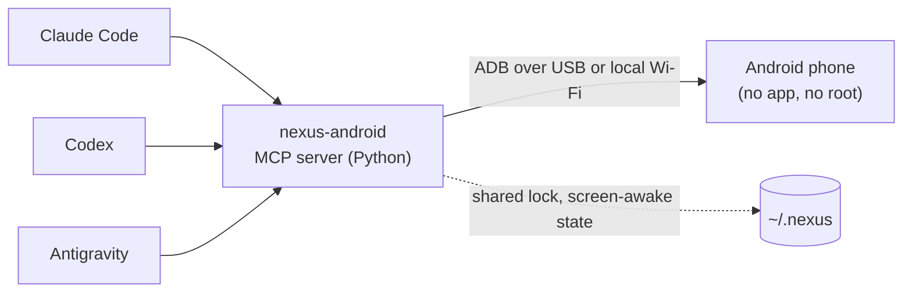

# NexusAndroid

<!-- mcp-name: io.github.pironjulien/nexus-android -->

[](https://github.com/pironjulien/NexusAndroid/releases)
[](https://pypi.org/project/nexus-android/)
[](https://github.com/pironjulien/NexusAndroid/actions/workflows/tests.yml)
[](https://github.com/pironjulien/NexusAndroid/blob/main/LICENSE)
[](https://github.com/pironjulien/NexusAndroid/blob/main/pyproject.toml)
[](https://modelcontextprotocol.io)

[](https://julienpiron.fr/nexusandroid/)


**Android computer use for AI agents, over plain ADB.** One MCP server, `nexus-android`, lets Claude Code, Codex
and Antigravity see and drive a real Android phone: screen and UI tree, gestures, typing with accents and emoji,
SMS/RCS reading, prepared replies, notifications, files, settings. No root, no app to install on the phone, no
cloud relay: a USB cable or the local Wi-Fi.

Built and tested on a Samsung Galaxy Fold (`SM-F971B`, One UI) with a Windows PC. Other Android phones with USB
debugging should work but have not been tested. Everything sent to the client is in English: server instructions,
tool descriptions and tool reports (results, refusals, errors).
Part of the Nexus family: [NexusWindows](https://julienpiron.fr/nexuswindows/)
([Claude](https://github.com/pironjulien/NexusWindows-Claude) ·
[Codex](https://github.com/pironjulien/NexusWindows-Codex) ·
[Antigravity](https://github.com/pironjulien/NexusWindows-Antigravity)),
[NexusBrowser](https://julienpiron.fr/nexusbrowser/) ([repo](https://github.com/pironjulien/NexusBrowser)),
[NexusAndroid](https://julienpiron.fr/nexusandroid/) ([repo](https://github.com/pironjulien/NexusAndroid)).
Project page: [julienpiron.fr/nexusandroid](https://julienpiron.fr/nexusandroid/).

## Quick start

1. Phone: Settings → About phone → tap *Build number* 7 times, then Developer options → **USB debugging** on.
   Plug it in and accept the PC's key on the phone.
2. PC: install [`uv`](https://docs.astral.sh/uv/) and the Android Platform Tools (`winget install Google.PlatformTools`).
   The server runs on Python 3.12 or newer; `uv` fetches one if needed.
3. Add the server to your agent (installed from [PyPI](https://pypi.org/project/nexus-android/) by `uvx`, no clone needed):

```bash
claude mcp add nexus-android --scope user -- uvx nexus-android
```

Then ask your agent: *"Look at my phone and tell me what is on the screen."*

<details>
<summary>Codex (<code>~/.codex/config.toml</code>)</summary>

```toml
[mcp_servers.nexus-android]
command = "uvx"
args = ["nexus-android"]
```
</details>

<details>
<summary>Antigravity, Claude Desktop, Cursor and other JSON clients</summary>

```json
{
  "mcpServers": {
    "nexus-android": {
      "command": "uvx",
      "args": ["nexus-android"]
    }
  }
}
```
</details>

If `adb` is not on the `PATH`, set `NEXUS_ANDROID_ADB` to its full path in the server's environment. Typing accents
and emoji needs the scrcpy server (Genymobile, Apache 2.0, version 5.0.1 pinned): the first time an agent types such
text, the server downloads it from the
[official scrcpy release](https://github.com/Genymobile/scrcpy/releases/tag/v5.0.1) on GitHub, checks its SHA-256
against the value written in the code and keeps it in `~/.nexus/nexus-android/tools`
([`install.ps1`](https://github.com/pironjulien/NexusAndroid#full-install-windows) fetches it ahead of time). If the
download is impossible (offline, proxy), accented text is refused with a message saying where to put the file; it is
never replaced by other text. ASCII typing works without it.

### Example prompts

- *"Open Google Maps and start navigation to the nearest pharmacy."*
- *"Read my last SMS from Alice and draft a reply saying I'll be 10 minutes late."* (drafted, never sent without your "yes")
- *"Turn on do not disturb and lower the brightness."*
- *"Pull the last three photos from the phone to my PC."*
- *"Run a checkup: battery, storage, security patch, apps installed outside the stores."*

## How it works



`look` returns a screenshot plus the numbered UI tree; `act` runs a batch of gestures, re-reading the screen before
each one and reporting what really happened. Messages, notifications, contacts and settings are read through
Android's own providers and `dumpsys`, never by scraping the screen.

## Why a shared server

Each agent has its own desktop computer use, but none of the three clients has a built-in tool for a phone. One
server avoids maintaining the same ADB access three times, and lets the three agents share one lock, one
screen-awake session and the same safeguards.

## Tools

| Tool | Role |
| --- | --- |
| `phone` | Connected phone (USB or Wi-Fi), model, screen, foreground app, fold posture, reboot detection (structured output) |
| `look` | Screen image and numbered `[N]` elements with text, state and center `@x,y`; `marks` draws the `[N]` numbers on the image (`auto`: all when few, else the unnamed elements; `all`; `none`) |
| `act` | Batched gestures: tap, long press, typing (accents and emoji included), clear, keys, scroll, swipe, wait, links (`geo:`, `google.navigation:`, `tel:` opens the dialer without calling, `mailto:`, `https://`); `then="changes"` returns only the elements added, changed and removed since the last list (unchanged ones counted, `[N]` kept valid), or the full list when the app or most of the screen changed |
| `launch` | Open an app by package or part of its name, or a precise screen: `action` (`android.settings.WIFI_SETTINGS`), `data` (deep link), `extras`; target resolved first and reported; calling, sending or paying directly needs `confirm=true`, banking and identity apps are never opened this way |
| `clipboard` | Read the phone's clipboard (codes masked, a lone code, password or token never shown) or write text to it, without pasting |
| `messages` | SMS and RCS conversations, read by contact name or number, attached photos; security codes masked; answers capped at about 60,000 characters, cut between messages, with a `before` cursor to read older ones |
| `draft` | Open SMS/RCS or WhatsApp with the reply already written, recipient by name or number (WhatsApp: country code from the SIM card); sent only after the user explicitly says "send" |
| `notifications` | Notifications on screen: app, time, title, text; security codes masked; `all` adds ongoing ones |
| `files` | Shared storage only (`/sdcard`): list newest first, `pull` to the PC (`~\Downloads\Telephone`), `push` to the phone; never overwrites, never deletes. On the PC: Downloads, Documents, Desktop, Pictures and Videos are free, anywhere else needs `confirm=true`; keys and secrets (`.ssh`, `.env`…) and the Windows Startup folder never |
| `info` | Read-only: last known location (accuracy, age, Maps link), recent calls, a contact's numbers, upcoming events (structured output) |
| `settings` | Read or change, then read back: Wi-Fi, Bluetooth, mobile data, location, NFC, do not disturb, brightness, media volume; turning Wi-Fi off is refused when the link goes through it (structured output) |
| `checkup` | Health report: system, security patch, battery, storage, memory, apps installed outside the stores, wireless debugging; `clean` clears caches |

Google Messages stores RCS messages in Android's messaging provider, like MMS, so the server reads them without going
through the screen. An RCS group only has an encoded address there: the server works out its members and names the
sender of each received message. A conversation archived or trashed in Google Messages stays readable and is labelled
as hidden in the app.

Reads are fast: every `adb shell content query` starts a Java process on the phone (about 1 s), so at the first
read the server pushes a 20 KB helper (`phone/NexusQuery.java`, built into `nexus-query.dex`) to `/data/local/tmp`
and starts it once with `app_process` under the shell identity, as scrcpy does: no app to install, no permission
beyond ADB's. It queries the providers the way Android's own `content` command does, read-only (`query` only), and
serializes the rows itself with length-prefixed values, so a message text can never pose as an extra row. Each start
draws a random token that goes into the socket name and comes back in every answer; any other server is refused. It
answers only connections from the shell or root user (adbd, checked by the kernel) and stops after 10 minutes without
a request. If the helper cannot run, reads fall back to `adb shell` with the same results; there, a read whose row
numbers or row count (checked against the same read reduced to `_id`) do not add up is refused rather than shown.

The same helper reads the screen: it opens one accessibility connection (`UiAutomation`, what `uiautomator dump` opens
and closes on every call) and keeps it, so `look` gets the UI tree, the screenshot (JPEG made on the phone) and the
screen state in one exchange. It is read-only (no gesture, no global action, no typing) and leaves the user's own
accessibility services running. Android allows only one such connection at a time: the helper is shared by every
agent, hands it back before any `uiautomator dump` fallback, on its own after 45 s without a screen read, and right after reading a protected (banking or identity) app, so
other tools (Appium, uiautomator2) can take it. The element list, its numbering, code masking and the refusal rules
are the same as with `uiautomator dump`.

## Performance

Measured on a Samsung Galaxy Fold: messages over USB through the shared daemon, the other rows over Wi-Fi:

| Read | Time |
| --- | --- |
| Conversation list (`messages()`) | 0.07 s (35 s before 0.5.0) |
| One conversation | 0.03 to 0.05 s |
| `phone` (Wi-Fi, link already known) | 0.19 s, one adb round trip |
| Location (Wi-Fi) | 0.11 to 0.15 s |
| `look` (list and image, Wi-Fi) | 0.17 to 0.19 s (2.9 s before); the first one after 45 s without a look: about 1.2 s |

## Safeguards

- **Paying, sending, calling, publishing, deleting for good, formatting, uninstalling, resetting, cancelling a subscription,
  making a repository public**: a button of this kind is refused without `confirm=true`, for every gesture aimed at
  it (tap, typing, clearing, swipe, `x,y` coordinates included). The agent sets it on the user's explicit order for
  that gesture, or after their "yes". The labels come from one policy file shared with the desktop tools
  (`garde-fous.json`), matched without accents or case and in every listed form ("Envoyez", "Payez", "Paiement",
  "Commandez", "Checkout", "Appeler"...). Everything else is free: deleting to the trash, accepting, sharing.
  A generic "OK" or "Validate" needs it on a screen that talks about a payment or a format. In a messaging, mail,
  social or phone app, a clickable icon with no name at all (often the send or call button) needs it too. Enter, call keys and any key
  outside a short safe list need it as well.
- **Target checked on the current screen**: the UI and the phone state (lock, foreground app) are read again in
  one round trip just before each gesture; a changed `[N]` or a spot with nothing readable is refused. Reports: ✓ effect read back, ~ sent but not verified, ✗ refused or failed.
- **One phone only**: the owner's phone is identified by its hardware serial number, recorded at the first USB
  connection; emulators, TV boxes and other devices are ignored. One agent at a time drives it (lock shared by all
  servers on the PC, and by the sessions of the shared daemon); another one waits 30 seconds at most, then is told
  the phone is busy. A call the client cancels (or a client that disconnects) stops before the next step of a batch.
- **Banking, payment, crypto, gambling, identity, authenticators**: look, scroll and wait freely; tap, type or
  swipe only with `confirm=true` (the user's order to navigate); a money or send button, or an unnamed icon, never,
  even with `confirm=true`; a link (`open_url`) or an intent (`launch` with `action`/`data`) that would open one of
  them, even as one choice among others, is refused (a deep link can prepare a payment).
- **Intents and links that act on their own** (`CALL`, sending a text without review, uninstalling, resetting,
  payment actions, `upi:`/`bitcoin:`/`payto:` links, auto-send extras): `confirm=true`.
- **Codes received by SMS or shown in notifications**: masked before the agent reads them, and blacked out on the
  image (the `[N]` badges are drawn afterwards: they can only cover, never reveal). In the clipboard, a lone code, or
  a single word that looks like a password or a token, is not shown at all. When the UI tree cannot be read, codes cannot be located, so the image is not sent unless `look` gets
  `confirm=true` (with the user's agreement).
- **Passwords**: no typing into a password field.
- **Locked phone**: no gestures. The user unlocks it; no code is ever entered.
- **Text read** on screen or in messages is data, never instructions.
- **User holding the phone**: no gesture mixes with theirs. If the phone was touched in the last 3 seconds (and not
  by an agent), the server waits up to 10 seconds, then refuses.
- **Link lost during a gesture**: reported as `?` (effect unknown), never as a plain failure: the agent looks again
  before redoing it, so nothing is sent twice. A read with no answer (Wi-Fi gone) fails after 10 seconds (5 for the
  screen state) instead of minutes, and the next call looks for the phone again.
- **Fold folded or unfolded** since the last image: `x,y` targets are refused until a new `look`.
- **Reboot**: `phone` and `look` say once that the phone restarted; when it cannot be found, the message reminds that
  Android turns wireless debugging off after a reboot or a network change.
- **Other control tools** (mobile-mcp, Appium, Shizuku, another scrcpy) left running on the phone can block the UI
  tree: `checkup` and the error name them.

## Screen kept on while the agent works

Unlocking again and again while an agent works is tedious, but a phone used to pay must not stay unlocked. So, at the
first gesture (`act`, `launch`, `draft`) on a phone **the user has unlocked**, the server saves the screen timeout
(`screen_off_timeout`) and raises it to 5 minutes, a delay Android counts again from every gesture; `phone` shows
until when. If the server is killed, the screen still turns off (and locks) at most 5 minutes after the last gesture.
While the agent only looks, a screen that is on gets a wake-up key every 3 minutes (no visible effect), so it does
not turn off during a long observation.

About 2 minutes after the last gesture of any agent, the original timeout is restored and the screen is turned off,
which locks the phone again. If the user is holding the phone at that moment, or changed the timeout themselves, the
screen is left alone. The original value is saved once (`~\.nexus\nexus-android\awake.json`) and shared by all
servers under the common lock: one save, one restore, never the raised value taken for the original. After a crash,
the next server to start restores it. The server never unlocks the phone.
`NEXUS_ANDROID_AWAKE_IDLE` (seconds, default 120) changes the delay; `NEXUS_ANDROID_KEEP_AWAKE=0` turns it off.

## Known limitations

- Gestures go through the real screen, on purpose: the user sees the agent working. No invisible virtual display.
- Accented text and emoji go through the clipboard (Android's `input text` only takes ASCII): the scrcpy server
  (Genymobile, Apache 2.0, version and SHA-256 pinned, downloaded by `install.ps1` or at the first accented text) runs
  only during the paste, then the previous clipboard is put back. Samsung's clipboard history may keep the pasted text.
- Notifications: Android only keeps the app name of dismissed ones, not their text.
- An app protected by `FLAG_SECURE` produces a black screenshot; the server says so and the `[N]` elements stay
  readable.
- The link is USB or local Wi-Fi through wireless debugging, paired with each PC. ADB does not work over Bluetooth.
- Windows only for now: the installer, the tests and the default paths target Windows.

## Rejected options

- **Companion app on the phone**: notifications, typing with accents, files and settings all come from ADB itself; an
  app would only add control away from USB and home Wi-Fi, which is rarely needed.
- **Invisible screen**: seeing the agent work on the real screen is a feature.
- **Internet relay** (tunnels, VPN): USB or local Wi-Fi only.

## Full install (Windows)

An alternative to `uvx`: one local environment, registered in the clients found on the PC, with the scrcpy server
fetched ahead of time.

Prerequisites: Windows, PowerShell 7, [`uv`](https://docs.astral.sh/uv/) and the Android Platform Tools
(`winget install Google.PlatformTools`). On the phone: Developer options → USB debugging.

```powershell
git clone https://github.com/pironjulien/NexusAndroid
cd NexusAndroid
pwsh -NoProfile -File install.ps1          # environment, scrcpy server, Codex/Antigravity registration, tests
pwsh -NoProfile -File install.ps1 -Live    # plus a run on the connected phone (types then clears a draft SMS, never sends)
```

What the script does (safe to run again, for example after `git pull`):

- Environment: `~\.nexus\nexus-android\venv`, with a copy of the package (not a link to the clone).
- scrcpy server: downloaded from the official release, kept only if its SHA-256 matches.
- Codex, when `~\.codex` exists: a `[mcp_servers.nexus-android]` table in `~\.codex\config.toml` (stdio, the
  environment's Python), replacing an older `nexus-android` table and leaving the rest of the file alone. The previous
  file is copied first to `~\.nexus\nexus-android\backups`.
- Antigravity, when `~\.gemini\antigravity` or its config exists: a `nexus-android` entry in
  `~\.gemini\config\mcp_config.json`, with the same backup.
- Claude Code: the script prints the `claude mcp add` command to run for the same environment; it never calls the
  Claude CLI itself.
- Tests: `test.ps1` (offline, no phone). `-SkipTests` skips them, `-NoRegister` leaves the client configs alone.

Each client then starts its own server over stdio. They share the phone lock and the screen-awake state through
`~\.nexus`; for a single process shared by all clients, see
[Shared daemon](https://github.com/pironjulien/NexusAndroid#shared-daemon-optional).

### Cable-free Wi-Fi, once per PC

1. Phone: Settings → Developer options → Wireless debugging → Pair device with pairing code.
2. PC: `adb pair <ip>:<port>`, then enter the code shown on the phone.

From then on, `nexus-android` finds the phone on the local Wi-Fi. Since One UI does not announce the phone over mDNS,
the server records its Wi-Fi address and the wireless debugging port every time it is plugged in over USB. This port
changes after a reboot or a network change: plugging in over USB once is then enough. The last known address is
tried first, then mDNS; only when the PC is on the same network does the server look for the new port, checking with
an ADB handshake before connecting. When the phone cannot be found, the server does not search the Wi-Fi again for
2 minutes (a cable plugged in is still seen at once). The cable takes priority when
it is plugged in. `NEXUS_ANDROID_SERIAL` forces a specific device, by serial number or `ip:port` address.

**No shared Wi-Fi network** (office PC on Ethernet only, with a Wi-Fi card): turn on the phone's hotspot and connect
the PC to it, then, with the cable plugged in once, run `adb tcpip 5555`. The server records the phone's hotspot
address and finds it there after the cable is removed. TCP mode lasts until the phone restarts (or `adb usb`). Raise
the PC's Wi-Fi interface metric if its internet traffic should keep going through Ethernet rather than the phone's
mobile data.

> **Not encrypted.** Unlike wireless debugging (paired, TLS), `adb tcpip 5555` is classic ADB over plain TCP: the
> traffic, screenshots and messages included, can be read on that network, and the port stays open on it. Use it only
> on the phone's own hotspot or another network you control, and turn it off afterwards with `adb usb`.

## Shared daemon (optional)

By default each client starts its own `nexus-android` process. To run a single process for all of them, start the
server in HTTP mode:

```powershell
$env:NEXUS_MCP_TOKEN = "<random string, 32 characters or more>"   # or NEXUS_MCP_TOKEN_FILE = path of a file holding it
nexus-android --http 16180
```

It serves MCP Streamable HTTP on `127.0.0.1` only (default port 16180), at `http://127.0.0.1:16180/mcp`, and refuses
any request without the header `Authorization: Bearer <token>` (HTTP 401); it does not start without a token. Point
each client at that URL with that header. Each MCP session keeps its own `[N]` numbering and conversation list; the
ADB link and the phone lock are shared. Starting the daemon (at logon, for example) is up to you: `install.ps1` does
not set it up. The token keeps a misconfigured client or a stray session from driving the phone; it is no protection
against malicious software running on the same PC, which can reach the phone directly through ADB (see
[SECURITY.md](https://github.com/pironjulien/NexusAndroid/blob/main/SECURITY.md)).

## Privacy

NexusAndroid runs entirely on your PC and talks to your phone over ADB (USB cable or local Wi-Fi). It has no
account, no telemetry, no analytics and no cloud relay. Its only internet request is the one-time download of the
pinned scrcpy server from GitHub, the first time accented text is typed (skipped when `install.ps1` already fetched
it).

- **What it reads**: the screen and UI tree, SMS/RCS messages, notifications, files in shared storage, location,
  recent calls, contacts and calendar, only when the agent calls the matching tool. Security codes are masked before
  the agent sees them.
- **Where it goes**: tool results are returned to the AI client you connected (Claude, Codex, Antigravity…). That
  client may send them to its model provider under its own privacy policy; NexusAndroid sends nothing anywhere else.
- **What it stores on the PC**, under `~/.nexus/`: the phone's serial number, Wi-Fi address and wireless debugging
  port, the saved screen timeout, a lock file, the pinned scrcpy server, and, with `install.ps1`, its environment and
  backups of the client configs it edits. Files you `pull` go to `~/Downloads/Telephone`. The server writes no
  messages, screenshots or logs to disk.
- **On the phone**, in `/data/local/tmp`: the two helpers (`nexus-scrcpy.jar`, `nexus-query-*.dex`) stay there; the
  UI dump (`nexus-android-ui-*.xml`) and the temporary read folders (`nexus-q-*`, `nexus-p-*`) are deleted right after
  each read. The read helper stops by itself after 10 minutes without a request.
- **Removing it**: delete `~/.nexus/nexus-android/` and `~/.nexus/android.lock`, remove the `nexus-android` entry
  from each client's config, run `adb shell "rm -rf /data/local/tmp/nexus-*"` (helpers, UI dumps and any read folder
  left by an interrupted read), and revoke the PC's key on the phone (Developer options → Revoke USB debugging
  authorizations).

Questions or concerns: open an issue, or see [SECURITY.md](https://github.com/pironjulien/NexusAndroid/blob/main/SECURITY.md)
for private reports.

## Development

```powershell
pwsh -NoProfile -File test.ps1   # ruff, pyright and the unit tests, offline, no phone needed
```

## License

[MIT](https://github.com/pironjulien/NexusAndroid/blob/main/LICENSE). Not affiliated with Google, Samsung, Anthropic, OpenAI or Genymobile.
